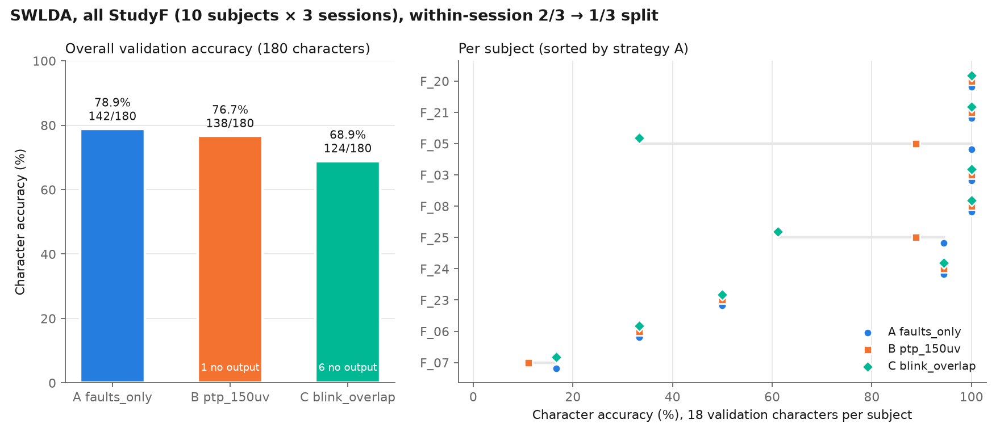
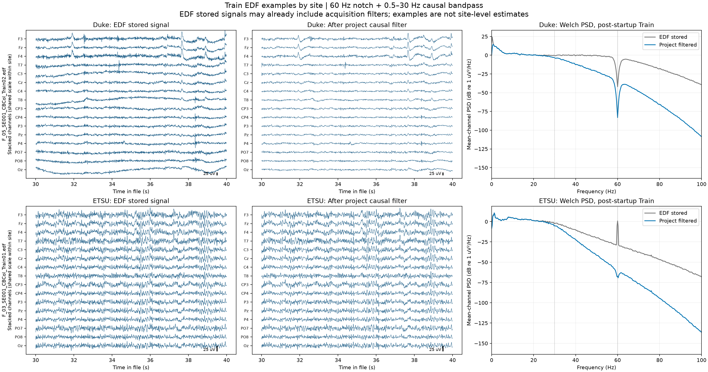
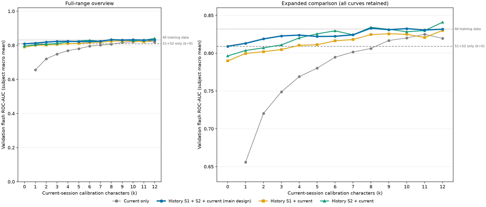
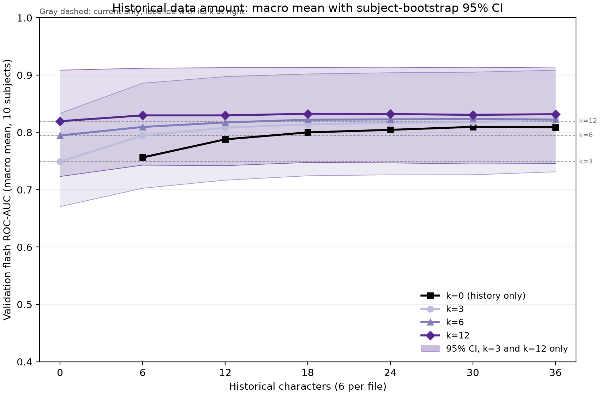
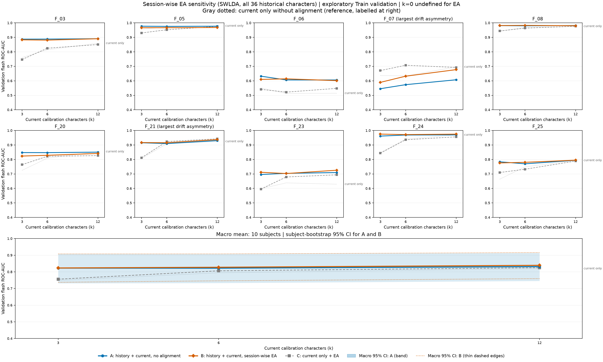

# Toward Personalized P300 BCI Decoding

Development pipeline for the bigP3BCI dataset (StudyF, row/column P300 speller): causal
preprocessing, epoch-level quality control, blink-candidate detection, and a project-owned SWLDA
classifier. The analyses ask how epoch rejection, current-session calibration data and historical
sessions affect decoding, as groundwork for personalized models (EEGNet next).

All analyses use Train EDFs; the Test split is held out (see [Test-set policy](#test-set-policy)).



*SWLDA on all StudyF Train data: 10 subjects × 3 Sessions, chronological 2/3 → 1/3 split of complete
characters within each Session. A = basic faults only, B = + 150 µV PTP ceiling, C = + blink overlap.
Validation accuracy: A 78.9%, B 76.7%, C 68.9% (180 characters).*

## Results at a glance

| Analysis | Notebook | Main finding (validation flash ROC-AUC unless stated) |
|---|---|---|
| Epoch rejection A/B/C, all StudyF (v3) | [06](notebooks/06_swlda_comparison.ipynb) | Character accuracy A 78.9%, B 76.7%, C 68.9%; adding rejection rules lowered accuracy |
| Calibration budget | [07](notebooks/07_swlda_calibration_budget.ipynb) | History S1+S2 alone (k=0) 0.809; current only rises from 0.749 (k=3) to 0.820 (k=12); history + current 0.823 at k=3 and 0.832 at k=12 |
| Historical data amount | [08](notebooks/08_history_amount_exploratory.ipynb) | Gains from history are largest at small k and flatten after about 18 historical characters (exploratory) |
| Euclidean alignment | [09](notebooks/09_ea_sensitivity.ipynb) | Macro B−A +0.001 / +0.005 / +0.007 at k=3/6/12, all intervals include 0; F_07 +0.04 to +0.07 (exploratory) |

## Repository layout

```
configs/    frozen JSON configurations, one per experiment
src/        reusable modules (data policy, preprocessing, QC, blink detection, SWLDA, analyses, figures)
scripts/    run_*  -> run an experiment and write outputs/<name>/
            build_*_notebook.py -> regenerate the matching report notebook
            plot_* / audit_* -> redraw figures / independently check saved results
notebooks/  report notebooks 01–09 and appendix A1, read from outputs/
learning/   MNE tutorial notebook (not part of the analysis)
tests/      unittest suite
docs/       protocols, experiment log, detector freeze note, figures shown here
data/       (not tracked) raw EDFs
outputs/    (not tracked) generated results; recreate with scripts/
```

## Setup

```bash
conda create -n bigp3bci python=3.12
conda activate bigp3bci
pip install -r requirements.txt
python -m ipykernel install --user --name bigp3bci   # kernel used by the notebooks
```

Download the bigP3BCI dataset from PhysioNet (https://physionet.org/content/bigp3bci/) so that the
StudyF EDFs sit at `data/raw/bigP3BCI-data/StudyF/<subject>/SE00x/Train/<run>/*.edf`. In restricted
Windows environments, set `$env:_MNE_FAKE_HOME_DIR=$PWD.Path` before running scripts.

Notebooks 01 and 04 are committed without outputs. Register the output filter once per clone
(`.gitattributes` applies it to those two files only):

```bash
git config filter.nbstripout.clean "python -m nbstripout"
git config filter.nbstripout.smudge cat
git config filter.nbstripout.required true
```

Run the tests:

```bash
python -m unittest discover -s tests -v
```

## Test-set policy

Analyses read Train EDFs only (`<subject>/<session>/Train/CBCol/*.edf`). The Test split (Static, Dyn,
DynBigram) is held out for the final evaluation. Scripts check every EDF and cached processing record
with `src/bigp3bci_data_policy.py`, and `tests/test_data_policy.py` fails if code names a Test-split
folder. Two earlier exceptions are recorded in [`docs/experiment_log.md`](docs/experiment_log.md): the
raw-data inspection (notebook 01) read Test EDF headers and state channels to count characters, and a
Static experiment read Test/Static data; its outputs were deleted. The history-amount and EA analyses
were run after those results had been seen and are labelled exploratory.

## Notebooks

| Notebook | Topic | Script / config |
|---|---|---|
| [01](notebooks/01_data_inventory.ipynb) | Data inventory and raw inspection, EDF inspection, artifact QC (no outputs) | interactive |
| [02](notebooks/02_preprocessing.ipynb) | Duke/ETSU filter examples; preprocessing and candidate detection (expanded pilot, causal pilot) | `plot_filter_site_examples.py`, `build_expanded_pilot_notebook.py`, `build_causal_pilot_notebook.py` |
| [03](notebooks/03_blink_review.ipynb) | Blink detection summary, candidate review, false positives, threshold validation | each builder updates its own chapter |
| [04](notebooks/04_blink_boundaries_secondary.ipynb) | Blink main-wave / recovery localization and bounded-prominence confirmation (no outputs) | `refine_blink_boundaries.py`, `run_bounded_prominence_secondary.py` |
| [05](notebooks/05_epoch_policy_comparison.ipynb) | Three epoch policies A/B/C | `compare_epoch_policies.py`, `configs/three_policy_comparison.json` |
| [06](notebooks/06_swlda_comparison.ipynb) | SWLDA main result (all StudyF, v3); v2 and v1 in the appendix | `build_three_session_experiment_notebook.py --all-studyf` |
| [07](notebooks/07_swlda_calibration_budget.ipynb) | SWLDA calibration budget, last-six SE003 Train validation | `run_swlda_calibration_budget.py`, `configs/swlda_calibration_budget.json` |
| [08](notebooks/08_history_amount_exploratory.ipynb) | Historical-file amount H × current budget k (exploratory) | `run_history_amount_exploratory.py`, `configs/history_amount_exploratory.json` |
| [09](notebooks/09_ea_sensitivity.ipynb) | Session-wise Euclidean alignment sensitivity (exploratory) | `run_ea_sensitivity.py`, `configs/ea_sensitivity.json` |
| 10 | EEGNet (planned) | [`docs/eegnet_protocol.md`](docs/eegnet_protocol.md) |
| [A1](notebooks/A1_continuous_eeg_manual_qc.ipynb) | Appendix: continuous EEG manual QC record | interactive (Qt) |

Notebooks 01–04 and 06 combine related reports: the main result comes first and earlier experiments
follow as appendix chapters. Each `build_*_notebook.py` rebuilds only its own chapter (unexecuted) and
keeps the others. To run one chapter, restart the kernel and start from that chapter's initialization
cell. `python scripts/notebook_reports.py` merges any report files that are not yet consolidated.

## Reproduction

Run from the repository root with the `bigp3bci` environment. Each run writes to its own directory under
`outputs/` and records configuration and input hashes; use a new `--output` directory to rerun an
experiment whose results should be kept.

```bash
# Preprocessing and blink detection
python scripts/run_causal_pilot.py                      # notebook 02
python scripts/run_expanded_pilot.py                    # notebook 02
python scripts/plot_filter_site_examples.py             # notebook 02 filter figure
python scripts/compare_epoch_policies.py                # notebook 05
python scripts/refine_blink_boundaries.py               # notebook 04
python scripts/run_bounded_prominence_secondary.py      # notebook 04
python scripts/measure_local_plateau_excursions.py

# SWLDA main result (v3)
python scripts/run_all_studyf_preprocessing.py
python scripts/run_swlda_rejection_experiment.py --config configs/swlda_all_studyf.json --output outputs/swlda_all_studyf_v3
python scripts/audit_swlda_saved_experiment.py outputs/swlda_all_studyf_v3
python scripts/plot_swlda_all_studyf_accuracy.py
python scripts/build_three_session_experiment_notebook.py --all-studyf   # notebook 06

# Calibration budget and exploratory analyses
python scripts/run_swlda_calibration_budget.py          # notebook 07 (includes weighted log-loss)
python scripts/add_weighted_logloss.py                  # only for runs saved before log-loss was added
python scripts/plot_swlda_calibration_budget.py
python scripts/check_session_drift.py
python scripts/run_history_amount_exploratory.py        # notebook 08
python scripts/audit_history_amount_exploratory.py
python scripts/plot_history_amount.py
python scripts/run_ea_sensitivity.py                    # notebook 09
python scripts/plot_ea_sensitivity.py
python scripts/summarize_blink_label_association.py
```

Rebuild a report with its `build_*_notebook.py` script, then execute it with the `bigp3bci` kernel.
`run_all_studyf_preprocessing.py` reuses cached per-EDF results and can be restarted after an
interruption.

## Experiments

### Continuous EEG filter examples by site (notebook 02)



The figure uses the alphabetically first Train EDF in the preprocessing manifest for each site: Duke
F_05_SE001_CBCol_Train02 and ETSU F_03_SE001_CBCol_Train01. Each row shows all 16 channels at
30–40 s before and after the causal 60 Hz notch and 0.5–30 Hz bandpass, with identical waveform scales
within a site. Welch spectra use the full recording after the 10 s startup period, averaging channels
in linear power before conversion to dB. The stored signals already include each site's acquisition
filters. `plot_filter_site_examples.py` writes `outputs/filter_site_examples/` (figure, PSD tables,
provenance) and updates the figure in notebook 02.

### Causal preprocessing (notebook 02)

Configuration `configs/causal_pilot.json`, implementation `src/bigp3bci_preprocessing.py`.

- **Filtering:** 16 EEG channels; 60 Hz notch (Q=30) and Butterworth 0.5–30 Hz bandpass (order 4,
  band-pass order 8) as causal SOS filters. Each EDF starts from the steady state of its first sample
  and keeps filter state across 1 s blocks; state is not carried across EDFs. The first 10 s of each
  EDF are a startup period and their epochs are invalid. Event channels are not filtered and events are
  not moved.
- **Epochs:** `[onset, onset + ceil(0.8·fs))`, 205 samples at 256 Hz, baseline=None. StimulusType 0 is
  non-target and 1 is target; a character ends at the SelectedTarget rising edge.
- **Continuous QC:** fixed-threshold 2 s windows with 1 s steps, checking non-finite, zero, constant,
  low PTP/STD, large amplitude and large swings. A channel with at least 10 s of history and 20%
  abnormal windows is a persistent candidate: its epochs get `epoch_qc_status=pending_channel_policy`
  and the file `classification_eligible=false`, so downstream code checks both `valid_epoch` and
  `classification_eligible`. Channels are never dropped or interpolated.
- **PTP candidates:** (0.5, 150), (0.5, 250) and (0.2, 350) µV after filtering, fixed in advance.
- **Outputs:** per EDF under `outputs/causal_pilot/<edf_stem>/`: continuous EEG, all epochs, event
  metadata and QC, per-channel PTP, window metrics, channel candidates, threshold comparisons, valid
  flashes per character, and `report.html` with PSDs, waveforms, filter response and ERPs.

Pilot (2026-11-24): F_05_SE001_CBCol_Train02 and F_03_SE001_CBCol_Train01, 756 flashes and 6 characters
each; 734 kept (97.09%), all 22 exclusions in the startup period; no persistent channel candidates.

### SWLDA epoch rejection: v1, v2 and v3 (notebook 06)

Policies: A = basic hard-fault and technical checks; B = A + 150 µV PTP ceiling; C = A + overlap with
an `old_candidate_overlap_v1` blink candidate. SWLDA is a project-owned forward/backward stepwise OLS
implementation (enter p<0.10, remove p>0.15, at most 60 features) on 256 fixed window-mean features;
scaling and feature selection use each policy's retained training epochs. Rejected flashes get no
score; character evidence is the mean score when lit minus the mean score when unlit.

| Version | Data | Config / output | Validation accuracy A / B / C |
|---|---|---|---|
| v1 | 12 Train EDFs, 6 subjects, 11 subject/session models | `swlda_rejection_experiment.json` → `outputs/swlda_rejection_experiment_v1` | 75.0% / 70.8% / 50.0% (24 characters) |
| v2 | 54 Train EDFs, 6 subjects × 3 Sessions | `swlda_three_sessions.json` → `outputs/swlda_three_sessions_v2` | see notebook 06 appendix |
| v3 | 90 Train EDFs, all 10 StudyF subjects × 3 Sessions | `swlda_all_studyf.json` → `outputs/swlda_all_studyf_v3` | 78.9% / 76.7% / 68.9% (180 characters) |

Each subject/Session is a model group with a chronological 2/3 calibration split of complete
characters. In v1, policy C waits an additional 1.34 s after character completion to confirm blink
candidates, and four of its characters have no output (counted as errors). v2 runs with
`run_full_three_session_preprocessing.py` and `build_three_session_experiment_notebook.py` without the
`--all-studyf` flag; v1 is built with `build_swlda_experiment_notebook.py`.

### Calibration budget (notebook 07)



*Macro-mean validation flash ROC-AUC over 10 subjects against k current-session calibration
characters. Left: full 0–1 range; right: zoomed comparison. Dashed: history S1+S2 only (k=0, 0.809);
dotted: all training data (36 + 12 characters, 0.832).*

Each subject has its own models. History is all 36 SE001/SE002 Train characters. SE003 Train has 18
characters: the first 12 are the calibration pool and the last six are fixed validation, so k runs from
0 to 12. Curves: current only, history S1+S2 + current (main design), history S1 + current, and
history S2 + current; the all-data reference uses 36 + 12 characters. Features are the fixed 16 channels
and 256 window means with policy A; scaling and feature selection use each model's training epochs.

The primary metric is per-subject validation flash ROC-AUC, macro-averaged. Weighted flash log-loss is
computed after a training-only Platt sigmoid fitted on whole-character out-of-fold scores (current-only
k=1 uses in-sample scores); the two class means are weighted equally (constant p=0.5 gives ln 2 ≈
0.693). Current only falls from 2.47 at k=1 to 0.75 at k=12; history + current starts at 0.77 at
k=0 and is 0.75 at k=3. Character accuracy is secondary (6 validation characters per subject).
`add_weighted_logloss.py` adds log-loss to an existing run; `plot_swlda_calibration_budget.py` redraws
the figures from saved CSVs. A quick check run:
`--subjects F_05 --k-values 0 1 12 --output outputs/<new-name>`.

`src/bigp3bci_flash_early_stopping.py` provides flash-AUC and weighted-log-loss checkpoint selection
for EEGNet, and `bigp3bci_probability.binary_class_weights` computes training class weights; the rules
are fixed in [`docs/eegnet_protocol.md`](docs/eegnet_protocol.md).

### Historical data amount (notebook 08, exploratory)



Following the [protocol](docs/history_amount_exploratory_protocol.md), every subset of each subject's
six SE001/SE002 Train EDFs is fitted (H = 0–6 files, 6 characters each) with k ∈ {0, 3, 6, 12} current
characters: 2,550 SWLDA models, all retained. Results are averaged over subsets within subject, then
over subjects, with 10,000-replicate subject bootstrap intervals. Tables include paired differences from
current only and pure-S2 minus pure-S1 contrasts at H = 1–3. `eegnet_subset_plan.csv` fixes five seeded
subsets per H for EEGNet. Runs resume from checkpointed models when configuration and inputs are
unchanged.

### Euclidean alignment sensitivity (notebook 09, exploratory)



Following the [protocol](docs/ea_sensitivity_protocol.md), each session is aligned with
R_s^(−1/2), where R_s is the mean trial covariance (shrinkage 0.001) of that session's allowed data:
all SE001/SE002 Train characters and the first k SE003 calibration characters. EA is applied after
preprocessing and before feature extraction; window means commute with channel-space linear maps, so it
is applied to cached features (verified against raw epochs). k = 3, 6, 12. Conditions: A (history +
current, no EA; reproduces notebook 08 H=6), B (history + current, EA), current only, and C (current
only, EA).

Macro B−A is +0.001 / +0.005 / +0.007 at k = 3 / 6 / 12, all subject-bootstrap intervals include 0, and
5–6 of 10 subjects are positive, so results are reported per subject. F_07, the subject with the largest
session-drift asymmetry, improves by 0.04–0.07. The predeclared EEGNet follow-up rule was not met.

### Blink candidates and flash labels

`summarize_blink_label_association.py` (after all-StudyF preprocessing) summarizes all 68,004 Train
flashes by subject and subject/Session under `outputs/blink_label_association/`. A flash is
candidate-positive if its 0–800 ms epoch overlaps an `old_candidate_overlap_v1` interval. The
subject-stratified Mantel–Haenszel target/non-target odds ratio is 1.52 (95% interval 0.85–3.58,
50,000 whole-subject bootstrap samples, seed 20261125). F_05 has candidate overlap in 685/756 target
and 3,470/6,048 non-target flashes; F_25 in 275/756 and 2,109/6,048.

## Reference

### Other scripts

| Script | Purpose |
|---|---|
| `run_expanded_pilot.py` | Expanded Train pilot; writes `outputs/expanded_pilot`, part of the preprocessing input manifest |
| `check_session_drift.py` | Session covariance and amplitude drift (`configs/session_drift_descriptive.json`), used to choose EA subjects |
| `measure_local_plateau_excursions.py` | Local plateau metrics (`configs/local_plateau_metrics.json`) |
| `audit_history_amount_exploratory.py` | Independent audit of the history-amount analysis, shown in notebook 08 |
| `audit_studyf_abc_strategies.py` | Independent audit of the v3 A/B/C experiment |
| `plot_swlda_calibration_budget.py` | Redraw notebook 07 figures (AUC, accuracy, log-loss curves and small multiples) from saved CSVs without refitting |
| `plot_history_amount.py`, `plot_ea_sensitivity.py` | Redraw notebook 08 / 09 figures from saved results |
| `plot_filter_site_examples.py` | Duke/ETSU continuous EEG and PSD filter examples; updates notebook 02 |
| `build_double_blind_review.py`, `score_double_blind_review.py` | Double-blind blink review: anonymous packets and comparison of two independent forms |
| `export_blink_candidates.py`, `export_unmatched_blink_context.py` | Export candidate annotations and unmatched-candidate context for manual review |
| `audit_main_false_positive_reviews.py` | Audit saved main-wave false-positive reviews |

### Modules (`src/bigp3bci_*.py`)

| Purpose | Modules |
|---|---|
| Data access | `data_policy` |
| Preprocessing and QC | `preprocessing`, `continuous_qc`, `policy_comparison` |
| Blink detection and review | `expanded_pilot`, `candidate_review`, `blink_boundaries`, `boundary_review`, `blind_review`, `bounded_prominence`, `plateau_metrics` |
| SWLDA and evaluation | `swlda`, `probability`, `flash_early_stopping` |
| Exploratory analyses | `calibration_budget`, `history_amount`, `euclidean_alignment` |
| Figures | `budget_plot`, `figure_style` |

### Configurations

| Config | Entry script | Output |
|---|---|---|
| `causal_pilot.json` | `run_causal_pilot.py` | `outputs/causal_pilot` |
| `expanded_pilot.json` | `run_expanded_pilot.py` | `outputs/expanded_pilot` |
| `three_policy_comparison.json` | `compare_epoch_policies.py` | `outputs/three_policy_comparison` |
| `blink_boundary_localization.json` | `refine_blink_boundaries.py` | `outputs/blink_boundary_localization_v1` |
| `bounded_prominence_secondary.json` | `run_bounded_prominence_secondary.py` | `outputs/bounded_prominence_secondary_v1` |
| `local_plateau_metrics.json` | `measure_local_plateau_excursions.py` | `outputs/local_plateau_metrics_v1` |
| `swlda_rejection_experiment.json` | `run_swlda_rejection_experiment.py` | `outputs/swlda_rejection_experiment_v1` |
| `swlda_three_sessions.json` | `run_swlda_rejection_experiment.py --config` | `outputs/swlda_three_sessions_v2` |
| `swlda_all_studyf.json` | `run_swlda_rejection_experiment.py --config` | `outputs/swlda_all_studyf_v3` |
| `swlda_calibration_budget.json` | `run_swlda_calibration_budget.py` | `outputs/swlda_calibration_budget_train_validation_v1` |
| `session_drift_descriptive.json` | `check_session_drift.py` | `outputs/session_drift_descriptive_v1` |
| `history_amount_exploratory.json` | `run_history_amount_exploratory.py` | `outputs/history_amount_exploratory_v1` |
| `ea_sensitivity.json` | `run_ea_sensitivity.py` | `outputs/ea_sensitivity_v1` |

### Documents

- [`docs/history_amount_exploratory_protocol.md`](docs/history_amount_exploratory_protocol.md), [`docs/ea_sensitivity_protocol.md`](docs/ea_sensitivity_protocol.md): rules fixed before each exploratory run.
- [`docs/eegnet_protocol.md`](docs/eegnet_protocol.md): EEGNet rules; open items are filled in before the first training run.
- [`docs/blink_detector_freeze.md`](docs/blink_detector_freeze.md): frozen detector version, parameters and development files.
- [`docs/experiment_log.md`](docs/experiment_log.md): date, commit and Test access of every run.
- [`docs/reorganization_checklist.md`](docs/reorganization_checklist.md): repository reorganization plan.
